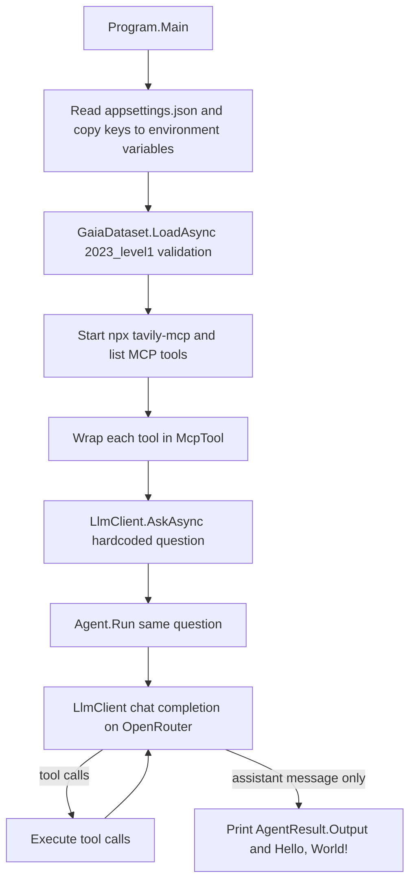

# AI.Agent.Console

A .NET 10 console application that loads the GAIA benchmark metadata and runs a small tool-calling agent. The agent talks to an OpenAI-compatible chat API (OpenRouter in the current entry point) and can call tools exposed by a [Model Context Protocol](https://modelcontextprotocol.io) server. The server started by `Main` is the Tavily MCP server (`tavily-mcp`).

There is one project, `AI.Agent.ConsoleApp`, in the namespace `AI.Agent.ConsoleApp`. It is an early code base: the entry point prints how many GAIA Level 1 validation problems it loaded, asks one hardcoded question, prints the agent reply, and then prints `Hello, World!`. It does not score the benchmark.

## What the program does

`Program.Main` always does the following:

1. Loads `appsettings.json` from the process working directory. The file is required.
2. Reads `OPENAI_API_KEY`, `HF_TOKEN`, `TAVILY_API_KEY`, and `OPEN_ROUTER_API_KEY` from that file and copies them into environment variables.
3. Downloads (or reuses a cache of) the GAIA `2023_level1` / `validation` parquet metadata and prints the problem count.
4. Starts `npx -y tavily-mcp@latest` over stdio, lists its MCP tools, and wraps each one in `McpTool`.
5. Creates an `LlmClient` for the model `openrouter/free` at `https://openrouter.ai/api/v1`.
6. Calls `LlmClient.AskAsync` with the prompt `Who won 2025 Nobel Physics award`. That return value is not printed.
7. Runs an `Agent` with the system instruction `You are a helpful assistant.` and the MCP tools, using the same prompt, and prints `AgentResult.Output`.
8. Prints `Hello, World!`.

The model id, endpoint, instruction, and user prompt are constants in `Program.CallAgent`. The executable does not parse command-line arguments.

`Program` also contains `SearchWeb` (the Tavily .NET client), `BuildMcpClient`, and `OpenAIChat` (a `Microsoft.Extensions.AI` tool loop, including a local `CalculateNew` function). `Main` does not call them.

## Tech stack

| Item | Value |
| --- | --- |
| Language | C# |
| SDK | .NET SDK **10.0.404**, from `global.json` (`rollForward`: `latestFeature`, so a later 10.0 SDK is accepted) |
| Target framework | `net10.0` |
| Project SDK | `Microsoft.NET.Sdk` (`OutputType` `Exe`, nullable reference types and implicit usings enabled) |
| Solution | `AI.Agent.Console.sln` |

NuGet packages referenced by `src/AI.Agent.Console/AI.Agent.ConsoleApp.csproj`:

| Package | Version | Role in this repo |
| --- | --- | --- |
| `OpenAI` | 2.15.0 | `ChatClient` / chat completions used by `LlmClient` |
| `Microsoft.Extensions.AI` | 11.0.0 | `IChatClient`, `AIFunction`, and the tool loop in `OpenAIChat` |
| `Microsoft.Extensions.AI.OpenAI` | 11.0.0 | `AsIChatClient()` adapter used by `OpenAIChat` |
| `Microsoft.Extensions.Configuration.Json` | 11.0.0 | Loads `appsettings.json` |
| `Microsoft.Extensions.Configuration.Binder` | 11.0.0 | Referenced. `Main` reads keys with the configuration indexer |
| `ModelContextProtocol` | 2.4.0 | Stdio MCP client (`McpClient`, `McpClientTool`) |
| `Tavily` | 1.0.1 | `TavilyClient` in `SearchWeb` |
| `Parquet.Net` | 6.1.0 | Reads GAIA metadata parquet files |

External services the code calls:

- **OpenRouter** (`https://openrouter.ai/api/v1`) through the OpenAI SDK. `Main` uses the model id `openrouter/free`. `LlmClient` can also target the default OpenAI endpoint when no URI is passed; the current entry point always passes the OpenRouter URI.
- **Tavily MCP** (`npx -y tavily-mcp@latest`), authenticated with `TAVILY_API_KEY`. `SearchWeb` can also call Tavily's HTTP API through the `Tavily` package; `Main` does not use that method.
- **Hugging Face** dataset [`gaia-benchmark/GAIA`](https://huggingface.co/datasets/gaia-benchmark/GAIA). `GaiaDataset` downloads parquet metadata with a bearer token. GAIA is a gated dataset.

`OPENAI_API_KEY` is loaded and exported, and nothing on the current `Main` path reads it.

## Repository structure

```
.
├── AI.Agent.Console.sln          # Solution; project is nested under a solution folder named src
├── global.json                   # Pins the .NET SDK to 10.0.404 (latestFeature roll-forward)
├── LICENSE                       # MIT License, copyright 2026 amit-tech-org
├── .gitignore                    # Standard .NET ignore list, plus src/**/appSettings.json
└── src/AI.Agent.Console/
    ├── AI.Agent.ConsoleApp.csproj
    ├── Program.cs                # Entry point and the sample methods above
    ├── Agent.cs                  # Multi-step tool-calling loop
    ├── LlmClient.cs              # OpenAI-compatible chat client
    ├── LlmRequest.cs
    ├── LlmResponse.cs
    ├── ExecutionContext.cs       # Events and step counter for one run
    ├── Event.cs
    ├── IContentItem.cs           # Message, tool call, or tool result
    ├── Message.cs
    ├── ToolCall.cs
    ├── ToolResult.cs
    ├── ContentType.cs            # ContentType, Role, and Status enums
    ├── BaseTool.cs
    ├── FunctionTool.cs           # Tool backed by a .NET delegate
    ├── McpTool.cs                # Tool backed by an MCP client tool
    ├── ToolDefinition.cs         # OpenAI-style function schema types
    ├── ToolDefinitionFactory.cs  # Serializes a tool definition for LlmProvider.OpenAI
    ├── GaiaDataset.cs            # Downloads and reads GAIA parquet metadata
    └── calculator_tool_definition.json
```

There is no test project, CI workflow, Dockerfile, or committed `appsettings.json`.

Build output (gitignored) is `src/AI.Agent.Console/bin/<Configuration>/net10.0/AI.Agent.ConsoleApp.dll` (and the `AI.Agent.ConsoleApp` executable).

## Architecture

Types live in the namespace `AI.Agent.ConsoleApp`.

### Conversation content

`IContentItem` is one of:

- `Message` — `Role` of `System`, `User`, or `Assistant`, plus text
- `ToolCall` — id, tool name, and a dictionary of arguments
- `ToolResult` — id, name, `Status` (`Success` or `Error`), and text content

`LlmRequest` carries system instructions, that content list, the `BaseTool` list, an optional `ToolChoice` (`auto`, `none`, `required`, or a function name), and an optional `ModelId`. `LlmClient` turns this into OpenAI chat messages and function tools. `LlmResponse` returns content items, an optional error string, and token counts under `UsageMetadata` (`input_tokens`, `output_tokens`) when the API provides usage.

`LlmClient.AskAsync` sends one user prompt and returns assistant text. `AskAsync<T>` appends a JSON schema generated from `T`, then deserializes the reply (a surrounding markdown fence is stripped).

### Agent loop

`Agent` is constructed with an `LlmClient`, optional instructions, a tool list, `maxRetries` (default 10), and a name (default `"Agent"`).

`Run` records the user prompt as an `Event` on an `ExecutionContext`, then repeats until it returns:

1. **Think.** Build an `LlmRequest` from the instructions, every content item collected so far, and the tools. `LlmClient.GenerateAsync` performs one chat completion.
2. **Act.** If the completion includes `ToolCall` items, look each tool up by name (case-insensitive) and call `BaseTool.ExceuteAsync`. Results are stored as another event. A missing tool or a thrown exception becomes a `ToolResult` with `Status.Error`.
3. Stop when the latest event has no tool call and no tool result, and return the assistant `Message` text as `AgentResult.Output`. The context is returned with it.

The loop also stops after `maxRetries` steps. `ExecutionContext.FinalResult` is part of the loop condition and is never assigned anywhere in the repo, so that condition does not end the run by itself. `Agent.AskAsync` is a separate one-shot path with the same retry count. `Main` uses `Run`, not `Agent.AskAsync`.

### Tools

`BaseTool` holds a name, description, and a tool definition object. The execute method is spelled `ExceuteAsync`.

- `McpTool` copies the MCP tool's JSON schema into an OpenAI function definition and forwards arguments to `McpClientTool.CallAsync`. Text blocks from the MCP result are joined with newlines.
- `FunctionTool` wraps a delegate. It builds an OpenAI function schema from the method name, a `DescriptionAttribute` on the method or an explicit description, and the parameters. A parameter of type `ExecutionContext`, or a parameter named `context`, is filled by the agent and left out of the schema. Other arguments are converted from the model's JSON values. `Task` and `ValueTask` return values are unwrapped.
- `ToolDefinitionFactory.Create` supports `LlmProvider.OpenAI` only.

`calculator_tool_definition.json` is a JSON schema for a calculator (`operator` of `add`, `subtract`, `multiply`, or `divide`, plus `first_number` and `second_number`). `Program` has a static field that reads this file from the working directory. No other code reads that field, and the built application does not require the file in order to reach configuration loading. The project file still copies it to the output directory. `Main` does not register this schema, or `FunctionTool`, with the agent.

### GAIA loader

`GaiaDataset.LoadAsync` accepts only the dataset id `gaia-benchmark/GAIA`. The `name` and `split` arguments select a parquet file:

| `name` | `split` | File under the dataset repo |
| --- | --- | --- |
| `2023_level1` | `validation` or `test` | `2023/<split>/metadata.level1.parquet` |
| `2023_level2` | `validation` or `test` | `2023/<split>/metadata.level2.parquet` |
| `2023_level3` | `validation` or `test` | `2023/<split>/metadata.level3.parquet` |
| `2023_all` | `validation` or `test` | `2023/<split>/metadata.parquet` |

Files are cached under `~/.cache/huggingface/datasets/gaia-benchmark/GAIA/`. Each row becomes a `GaiaProblem` (`TaskId`, `Question`, `Level`, `FinalAnswer`, `FileName`, `FilePath`) from the columns `task_id`, `Question`, `Level`, `Final answer`, `file_name`, and `file_path`. `Main` loads Level 1 validation and prints the count. It does not send those questions to the agent or compare answers.



## Prerequisites

- .NET SDK 10.0.404, or a later SDK in the 10.0 feature band (`global.json`).
- Node.js with `npx` on `PATH`. `Main` starts `npx -y tavily-mcp@latest`.
- Network access for NuGet restore, the Hugging Face dataset download, OpenRouter, and the `npx` package fetch.
- A Hugging Face account that has accepted the terms for [gaia-benchmark/GAIA](https://huggingface.co/datasets/gaia-benchmark/GAIA), and a token that can read it.
- An OpenRouter API key and a Tavily API key. The process exits while loading GAIA if the Hugging Face token is missing, which is before the agent is created.

`dotnet build AI.Agent.Console.sln` was run with SDK 10.0.404 for Debug and Release. Both configurations succeed with compiler warnings (nullable reference types, plus an unused exception variable in `Agent.AskAsync`) and no errors.

## Configuration

`Main` builds configuration with the working directory as the base path and `appsettings.json` as a required JSON file. Create that file in the directory you launch from. The name is lowercase `appsettings.json`, which is the string in `Program.cs`.

On a case-sensitive filesystem this is a different file from `appSettings.json`. The project file copies `appSettings.json` (capital S) to the output directory, and `.gitignore` ignores `src/**/appSettings.json`. Those two names do not satisfy the loader on Linux. Put the runtime file where the process is started, using the lowercase name.

Example, with placeholder values only:

```json
{
  "OPENAI_API_KEY": "your-openai-api-key",
  "HF_TOKEN": "your-hugging-face-token",
  "TAVILY_API_KEY": "your-tavily-api-key",
  "OPEN_ROUTER_API_KEY": "your-openrouter-api-key"
}
```

| Key | Copied to the environment by `Main` | Used by the current `Main` path |
| --- | --- | --- |
| `OPENAI_API_KEY` | `OPENAI_API_KEY` | No |
| `HF_TOKEN` | `HF_TOKEN` | Yes. `GaiaDataset` reads `HF_TOKEN` or, if that is empty, `HUGGING_FACE_HUB_TOKEN` |
| `TAVILY_API_KEY` | `TAVILY_API_KEY` | Yes. Passed into the Tavily MCP process |
| `OPEN_ROUTER_API_KEY` | `OPEN_ROUTER_API_KEY` | Yes. Passed to `LlmClient` |

`HUGGING_FACE_HUB_TOKEN` is not a key in the JSON loader. `GaiaDataset` reads it only when it is already an environment variable and `HF_TOKEN` is empty.

Do not commit real keys. `.gitignore` also ignores `.env`. This program does not load `.env` files.

If `appsettings.json` is missing, startup throws `FileNotFoundException` and reports the full path it expected. That path is the working directory, not the project directory and not the folder that contains the executable. Launching from the repository root looks for `<repo>/appsettings.json`. Launching from `src/AI.Agent.Console` looks for `src/AI.Agent.Console/appsettings.json`.

If the Hugging Face token is missing or the dataset terms have not been accepted, `GaiaDataset` throws `InvalidOperationException` and does not start the agent.

## Build and run

From the repository root:

```bash
dotnet build AI.Agent.Console.sln
dotnet build AI.Agent.Console.sln -c Release
```

Run from the directory that contains `appsettings.json`. With the file in the repository root:

```bash
dotnet run --project src/AI.Agent.Console/AI.Agent.ConsoleApp.csproj
```

Or, after a Debug build, from a working directory that contains `appsettings.json`:

```bash
dotnet exec src/AI.Agent.Console/bin/Debug/net10.0/AI.Agent.ConsoleApp.dll
```

The first run downloads GAIA metadata into `~/.cache/huggingface/datasets/gaia-benchmark/GAIA/` and asks `npx` to fetch `tavily-mcp`. Later runs reuse a non-empty cached parquet file. Expected console output is the Level 1 problem count, the agent answer, and `Hello, World!`.

A full run was not executed here: it needs the API keys and network calls above. Startup without `appsettings.json` was executed and fails with the `FileNotFoundException` described in Configuration.

## Tests

The solution has no test project. `dotnet test AI.Agent.Console.sln` restores and completes the VSTest target without running any tests.

## Usage examples

The shipped entry point does not take a prompt. Change the string in `Program.CallAgent`, or call the public types from other C# in this project. The snippets below match the constructors and methods that exist today. `DescriptionAttribute` is in `System.ComponentModel`. `StdioClientTransport` and `McpClientTool` are in `ModelContextProtocol.Client`.

Agent plus the Tavily MCP tools, which is the sequence in `CallAgent`:

```csharp
IList<McpClientTool> mcpClientTools = await GetMcpClientTools();
var tools = new List<BaseTool>();
foreach (McpClientTool item in mcpClientTools)
{
    tools.Add(new McpTool(item));
}

var client = new LlmClient(
    "openrouter/free",
    Environment.GetEnvironmentVariable("OPEN_ROUTER_API_KEY")!,
    new Uri("https://openrouter.ai/api/v1"));

string direct = await client.AskAsync("Who won 2025 Nobel Physics award");

var agent = new Agent(client, "You are a helpful assistant.", tools);
AgentResult result = await agent.Run("Who won 2025 Nobel Physics award");
Console.WriteLine(result.Output);
```

`GetMcpClientTools` in `Program` starts this stdio server:

```csharp
var clientTransport = new StdioClientTransport(new StdioClientTransportOptions
{
    Name = "Everything",
    Command = "npx",
    Arguments = ["-y", "tavily-mcp@latest"],
    EnvironmentVariables = new Dictionary<string, string?>
    {
        ["TAVILY_API_KEY"] = Environment.GetEnvironmentVariable("TAVILY_API_KEY")
    }
});
```

A local function tool. `FunctionTool` is not attached by `Main`. This follows `CalculateNew` and the schema `FunctionTool` generates from `DescriptionAttribute`:

```csharp
var calculator = new FunctionTool(Calculate);

var client = new LlmClient(
    "openrouter/free",
    Environment.GetEnvironmentVariable("OPEN_ROUTER_API_KEY")!,
    new Uri("https://openrouter.ai/api/v1"));

var agent = new Agent(client, "You are a helpful assistant.", new List<BaseTool> { calculator });
AgentResult result = await agent.Run("What is 1234 multiplied by 5678?");

static double Calculate(
    [Description("Arithmetic operation to perform")] string operation,
    [Description("First number for the calculation")] double a,
    [Description("Second number for the calculation")] double b)
{
    return operation switch
    {
        "add" => a + b,
        "subtract" => a - b,
        "multiply" => a * b,
        "divide" => a / b,
        _ => throw new ArgumentException("Invalid operation")
    };
}
```

GAIA metadata, including the call `Main` makes:

```csharp
IReadOnlyList<GaiaProblem> level1 = await GaiaDataset.LoadAsync(
    "gaia-benchmark/GAIA",
    "2023_level1",
    "validation");

Console.WriteLine($"Number of Level 1 problems: {level1.Count}");
Console.WriteLine(level1[0].Question);
```

Typed JSON reply from `LlmClient` (not used by `Main`):

```csharp
var client = new LlmClient(
    "openrouter/free",
    Environment.GetEnvironmentVariable("OPEN_ROUTER_API_KEY")!,
    new Uri("https://openrouter.ai/api/v1"));

var answer = await client.AskAsync<GaiaProblem>(
    "Return one example GAIA-shaped object with empty strings and level 1.");
```

`AskAsync<T>` asks the model for JSON matching `T`. It does not check that JSON against the GAIA dataset.

## What is not implemented

- No evaluation harness. GAIA rows are counted, not answered or scored.
- No command-line interface for the model, endpoint, tools, or prompt.
- `FunctionTool`, `calculator_tool_definition.json`, `CalculateNew`, `SearchWeb`, `BuildMcpClient`, and `OpenAIChat` are in the project and are not used by `Main`.
- Tool definitions can be emitted for `LlmProvider.OpenAI` only.
- No automated tests and no CI configuration.
- No sample `appsettings.json` is committed.

## Recent changes

History on `main` as of 25 November 2026:

| Commit | Summary |
| --- | --- |
| `b6b3d72` | Initial commit: .NET `.gitignore` and the MIT `LICENSE` |
| `dd4c520` | Added `Agent.cs` |
| `e70233d` | Added the solution, `global.json`, the console project, GAIA loader, LLM client, tools, `Program.cs`, and `calculator_tool_definition.json`. Also ignores `src/**/appSettings.json` |
| `6fa3965` | Merge of pull request #1 from `feature/agent` ("Initial changes"), which brought the commits above onto `main` |

## Contributing

Changes to `main` go through pull requests only. Open a pull request for review rather than pushing directly to `main`.

## License

[MIT License](LICENSE). Copyright (c) 2026 amit-tech-org.
